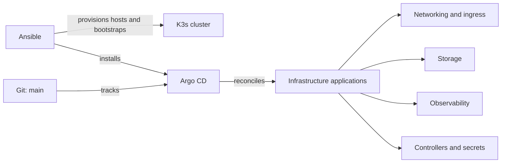

# 🏡 Homelab GitOps

**A small K3s cluster, built with Anible and kept in shape by Argo CD.**

Two Proxmox-hosted servers and a Raspberry Pi make up the control plane. This repository captures the host configuration, cluster bootstrap and infrastructure services that keep the lab running.

`Ansible` · `K3s` · `Argo CD` · `Cilium` · `Traefik` · `Longhorn`

> This is a working homelab configuration, tailored to its own hosts, network, storage and credentials.

## 🗺️ The big picture



Ansible installs Gateway API, Cilium, CoreDNS, Sealed Secrets and Argo CD, then creates the root Argo CD Application. That application points back to `kubernetes/bootstrap/`, which registers the projects and component Applications.

> **Changes to `main` can change the cluster.** Applications track `main` with automated sync, pruning and self-healing enabled, so removing a resource from Git can remove it from the cluster.

## 🧰 What's running

| Area | Components | Purpose |
| --- | --- | --- |
| Cluster | K3s, kube-vip | Kubernetes and a virtual API endpoint |
| Networking | Cilium, CoreDNS, external-dns | Cluster networking, load-balancer addresses and DNS |
| Ingress | Traefik, Gateway API, cert-manager | Routing and TLS certificates |
| Storage | Longhorn | Persistent storage |
| Operations | Argo CD, Sealed Secrets | Reconciliation and encrypted Kubernetes secrets |
| Observability | Prometheus, Grafana, metrics-server | Metrics and dashboards |

The manifests are the source of truth for addresses, hostnames, versions and component settings.

## 📁 Repository map

```text
ansible/
├── inventory/cluster/     Hosts, variables and encrypted vault
├── roles/                 Host setup, K3s and initial controllers
├── bootstrap.yaml         Initial SSH and sudo configuration
└── provisioning.yaml      Host and cluster provisioning

kubernetes/
├── bootstrap/             Argo CD root application, projects and apps
├── controllers/           Argo CD, cert-manager and Sealed Secrets
├── networking/            Cilium, CoreDNS, external-dns and Traefik
├── storage/               Longhorn
└── monitoring/            Prometheus, Grafana and metrics-server
```

Component directories contain Kustomizations, pinned Helm chart versions and values where applicable, and related Kubernetes resources.

## 🚀 Provisioning

Run Ansible from `ansible/` so its configuration, inventory and vault password script are picked up. The provisioning playbook requires Ansible 2.15 or newer.

### Before you start

- Ensure the control machine has SSH access and privilege escalation on the nodes, and the tools needed by the Kubernetes Kustomize/Helm lookups.
- Authenticate the 1Password CLI. `vault_password.sh` uses it to retrieve the Ansible Vault password; the encrypted inventory vault contains the Sealed Secrets key and certificate needed during bootstrap.
- Install the declared collections and ensure `community.general` and `ansible.utils`, which the playbooks also use, are installed.
- Review `inventory/cluster/hosts.yaml` and `inventory/cluster/group_vars/all/vars.yaml` against the intended hosts and disks.

```sh
cd ansible
ansible-galaxy collection install -r collections/requirements.yaml
```

> **Before running the playbooks:** `bootstrap.yaml` configures sudo and disables SSH password and root login, so verify key-based access first. `provisioning.yaml` can format configured disks, reboot hosts and restart K3s. Server provisioning runs one node at a time.

```sh
# On initially prepared hosts, if the SSH and sudo setup is needed:
ansible-playbook bootstrap.yaml

# Provision or update the cluster:
ansible-playbook provisioning.yaml
```

Provisioning fetches a kubeconfig to `ansible/kubeconfig`; the K3s role may also merge a context into the control machine's kubeconfig. Treat both as credentials. `ansible/kubeconfig` is not currently ignored by Git, so do not commit it.

`reset.yaml` is not a documented recovery procedure: it references a `k3s` role and `reset` task that are absent from this repository. Do not rely on it without first resolving that dependency and understanding its effects.

## 🔧 Making a change

1. **Edit the component.** Update its `values.yaml`, Kustomization or resource manifests. Helm-based components declare their chart and pinned version in `kustomization.yaml`; Argo CD renders these with Helm enabled.
2. **Adding a component?** Create its Kustomization and an Application in `kubernetes/bootstrap/`, register the Application in that directory's `kustomization.yaml`, and choose an appropriate project and destination.
3. **Check dependencies.** Consider CRDs, namespaces, storage, DNS and Gateway routes before merging.
4. **Render locally.** Use the checks below, then review the change knowing Argo CD will reconcile `main`.

### Local checks

From the repository root:

```sh
# Argo CD projects and Applications
kustomize build kubernetes/bootstrap >/dev/null

# A component without Helm charts
kustomize build kubernetes/networking/external-dns >/dev/null

# A Helm-based component (requires Helm and chart access)
kustomize build --enable-helm kubernetes/networking/cilium >/dev/null
```

From `ansible/`, `ansible-playbook provisioning.yaml --syntax-check` checks playbook syntax when the required collections and vault access are available. Rendering and syntax checks do not establish that a change will work on the live cluster.

## 🔐 Secrets and recovery

Kubernetes credentials use Sealed Secrets. Preserve the controller's sealing key and certificate for recovery; do not commit plaintext secrets or kubeconfigs. Ansible Vault protects the bootstrap key material, with its password retrieved through 1Password.
